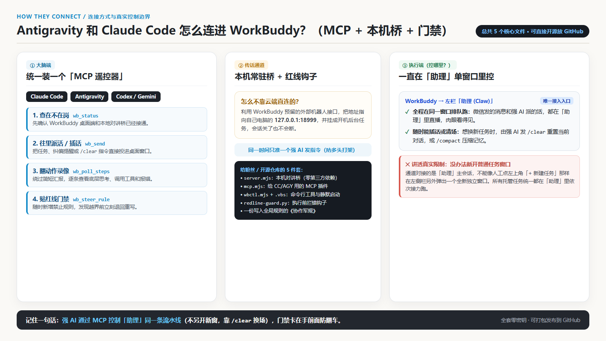
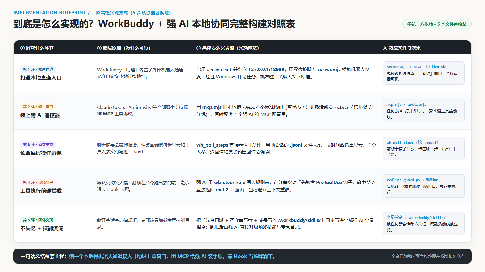

# workbuddy-claw-bridge

让 **Claude Code / Antigravity / Codex / Gemini CLI** 直接作为“后台技术总监”，通过本地轻量桥 + **MCP 工具** + **`PreToolUse` 红线钩子**，实时调度并监督 **WorkBuddy Desktop「助理（Claw）」**干活。

- **零云端转发**：纯本机 `127.0.0.1:18999` WebSocket + HTTP 桥，零第三方 npm 依赖（Node 18+ 原生可跑）。
- **过程全透明**：不只等 WorkBuddy 聊天摘要，直接读取会话 `.jsonl` 底层思考、工具入参和报错。
- **执行前硬刹车**：通过 `PreToolUse` Hook（`exit 2 + stderr`），在误删文件或高危命令执行前一毫秒当场拦停并打回上下文重写。
- **多端统一接入**：同一套 `mcp.mjs` 可同时配给 Claude Code、Antigravity、Codex、Gemini CLI。

---

## 一、架构与实现一图看懂





### 务必先知道的控制边界（不藏坑）

1. **全程在「助理（Claw）」单窗口内控制**：本地桥接入的是 WorkBuddy 左侧「助理」的主会话队列（与微信端派来的活同一条流水线，桌面端可实时直播观看），**不支持在 WorkBuddy 左侧栏另外新建普通独立任务窗口**。
2. **如何切换新任务**：任务做完想清场重来时，让强 AI 发一条 `/clear` 清空当前上下文，或发 `/compact` 压缩历史对话。
3. **单写者纪律**：你可以给多个强 AI 配上这套 MCP，但**同一时间只允许一个强 AI 主控向「助理」派活**，避免多头插话搞乱上下文。

---

## 二、目录结构

```text
workbuddy-claw-bridge/
├── claw-bridge/
│   ├── server.mjs          # 本地 RFC6455 WebSocket + HTTP 桥 (127.0.0.1:18999)
│   ├── mcp.mjs             # 暴露给 Claude Code / Antigravity 的标准 MCP 服务
│   ├── wbctl.mjs           # 命令行调试工具 (status / send / steps / steer)
│   └── start-hidden.vbs    # Windows 静默启动包装（不弹黑框）
├── hooks/
│   └── redline-guard.py    # PreToolUse 动态红线拦截器 (exit 2 + stderr)
├── scripts/
│   └── install.ps1         # Windows 一键复制与注册开机计划任务脚本
├── examples/
│   ├── mcp-configs.md      # 各强 AI 的 MCP 与 WorkBuddy settings.json 示例
│   └── agent-rules.md      # 防止新会话“失忆”的全局协作规范模板
└── docs/
    ├── architecture.png
    └── implementation-table.png
```

---

## 三、3 分钟安装上手（Windows 示例）

### 第 1 步：复制文件并启动本地常驻桥

```powershell
git clone https://github.com/gugug168/workbuddy-claw-bridge.git
cd workbuddy-claw-bridge
powershell -ExecutionPolicy Bypass -File .\scripts\install.ps1 -RegisterTask
```

> 为什么建议加 `-RegisterTask`？在 Windows 下如果由聊天会话临时拉起子进程，对话一关闭桥接进程会被系统清理；注册成独立的 Windows 计划任务后可随开机后台常驻。

### 第 2 步：在 WorkBuddy 中启用通道与红线钩子

对照 [examples/mcp-configs.md](./examples/mcp-configs.md)：
1. 在 `~/.workbuddy/settings.json` 的当前用户频道中开启 `wecomaibot`（指向 `ws://127.0.0.1:18999`），重启或刷新 WorkBuddy Desktop；
2. 在 `~/.workbuddy/settings.json` 的 `hooks.PreToolUse` 中挂上 `~/.workbuddy/hooks/redline-guard.py`。

运行自检确认连接成功（`wsConnected: true` 且 `wsAuthenticated: true`）：

```powershell
node "$env:USERPROFILE\.workbuddy\claw-bridge\wbctl.mjs" status
```

### 第 3 步：给 Claude Code / Antigravity 配上 MCP 与军规

1. 按 [examples/mcp-configs.md](./examples/mcp-configs.md) 把 `workbuddy-claw` 加入 Claude Code / Antigravity / Codex / Gemini CLI 配置；
2. 把 [examples/agent-rules.md](./examples/agent-rules.md) 放进你的 `CLAUDE.md` / `GEMINI.md` / `AGENTS.md`，新开会话就会自动记得这套协作方式。

---

## 四、暴露给强 AI 的 4 个 MCP 工具

| 工具名 | 作用 |
|---|---|
| `wb_status` | 检查本地桥接与 WorkBuddy「助理」WS 连接状态、当前绑定会话 ID 与 `.jsonl` 日志路径 |
| `wb_send` | 向「助理」主会话派发任务、追发纠偏或发送 `/clear`、`/compact`（长任务建议设 `wait_for_finish=false`） |
| `wb_poll_steps` | 直接读取底层 `.jsonl` 轨迹中的思考、`function_call` 工具入参、返回结果和流式输出 |
| `wb_steer_rule` | 动态增删 `live-steering.json` 拦截规则，命中即由 `PreToolUse` 钩子以 `exit 2` 当场刹停 |

---

## 五、直接发给 Claude Code / Antigravity 的联调提示词

```text
先调用 wb_status 确认桌面 WorkBuddy「助理」已在线。
若上一轮留有无关上下文，先发一条 /clear 清场，再把“只读统计 ~/.workbuddy/skills 子目录数量”通过 wb_send(wait_for_finish=false) 异步派进去。
运行期间持续用 wb_poll_steps 盯紧底层工具调用；如果发现尝试修改或删除文件，立刻调用 wb_steer_rule 写入红线拦截并修正。
完成后向我汇报底层步骤摘要和最终结果。
```

---

## 安全与隐私说明

- 本地服务默认仅绑定 `127.0.0.1` 回环地址，不对外网监听。
- 开源包中的 `hooks/redline-guard.py` 已移除作者私人路径与词表，仅保留基础高危指令拦截和通用动态 `live-steering.json` 机制。
- 扫码登录、公开发布、删除重要历史文件等动作仍建议由人最后点击确认。

MIT License
